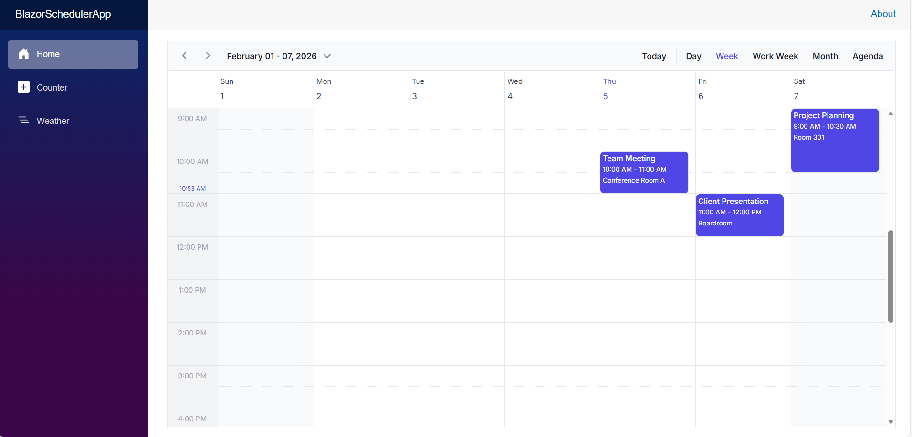

<!--
  README.md
  A step-by-step guide to integrate Syncfusion Blazor Scheduler with Minimal API
-->
# How to Integrate Syncfusion Blazor Scheduler with Minimal API Backend

This repository contains a sample full-stack application demonstrating how to synchronize appointments between in-memory storage and the Syncfusion Blazor Scheduler component. The ASP.NET Core Minimal API backend handles CRUD operations on Scheduler events, and the Blazor frontend delivers a modern, responsive scheduler interface for interacting with those events.

## Prerequisites

- **.NET SDK** (>= 10.0)

## Setup

### Cloning the repository
    
- Clone the repository to your local machine:

### Installation
 - Install required NuGet packages:
 
    ```bash
    dotnet restore
    ```


### Available Endpoints
The Minimal API in `Program.cs` exposes the following REST routes:
| Method | URL                          | Description                         |
| ------ | ---------------------------- | ----------------------------------- |
| GET    | `/api/appointments`          | Get all appointments                |
| GET    | `/api/appointments/{id}`     | Get appointment by ID               |
| POST   | `/api/appointments`          | Create a new appointment            |
| PUT    | `/api/appointments/{id}`     | Update an existing appointment      |
| DELETE | `/api/appointments/{id}`     | Delete an appointment               |


### Running the Application
1. Build the project:
    ```bash
    dotnet build
    ```
2. Run the application:
    ```bash
    dotnet run
    ```
3. The application will start on `http://localhost:5175`

4. You can perform CRUD operation on the scheduler that will be reflected in the in-memory storage.

## Output Preview

*Image illustrating the Syncfusion Blazor Scheduler*

## Troubleshooting
- **Port already in use**: Change the port in `Properties/launchSettings.json`
- **Theme not applying**: Clear browser cache or open in incognito mode